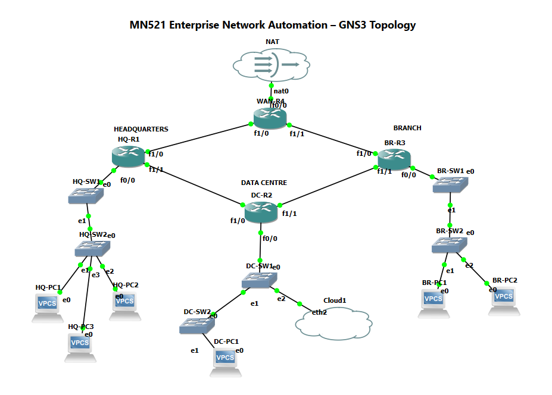

# Enterprise Network Automation Project

A portfolio-focused showcase of my hands-on network engineering and automation work completed as part of **MN521 Network Automation** at the Melbourne Institute of Technology.

> **Project note:** The original university project was completed in a group environment. This GitHub repository showcases components I personally designed, configured, tested, documented, or automated. The original GitLab repository is retained as the source of truth for project history and contribution evidence.

**Original group repository:**  
https://gitlab.com/mit-group2503334/mn521-project

---

## Highlights

- Built and tested a multi-site enterprise network using **Cisco IOS** and **GNS3**
- Implemented **VLANs, inter-VLAN routing, OSPF, DHCP, DNS, ACLs, NAT, SSH, NTP and Syslog**
- Automated Cisco configuration and verification using **Ansible, YAML, Jinja2 and Ansible Vault**
- Used **Terraform** for an AWS networking and EC2 infrastructure baseline
- Troubleshot routing, DHCP, interface, connectivity and automation issues
- Used Git-based version control to document project development and individual contributions

---

## Project Overview

The project involved designing and implementing a multi-site enterprise network connecting:

- Headquarters (HQ)
- Data Centre (DC)
- Branch office (BR)
- WAN / upstream network

The environment was built in **GNS3** using Cisco IOS routers and virtual hosts. The goal was to create a realistic enterprise network, configure core network services, test end-to-end connectivity, and introduce automation for repetitive network operations.

### Key Technologies

- Cisco IOS
- GNS3
- TCP/IP
- VLANs and trunking
- Inter-VLAN routing
- OSPF
- DHCP
- DNS
- ACLs
- NAT/PAT
- SSH
- NTP
- Syslog
- Ansible
- YAML
- Jinja2
- Ansible Vault
- Python / Bash
- Git
- Terraform

---

## Network Architecture



The topology used four routing roles:

| Device | Role |
|---|---|
| HQ-R1 | Headquarters router |
| DC-R2 | Data Centre router |
| BR-R3 | Branch router |
| WAN-R4 | WAN / upstream router |

Example WAN point-to-point networks included:

- `10.255.0.0/30`
- `10.255.0.4/30`
- `10.255.0.8/30`
- `10.255.0.12/30`

Site LAN addressing followed a structured design:

- HQ: `10.10.x.0/24`
- Data Centre: `10.20.x.0/24`
- Branch: `10.30.x.0/24`

---

## My Contributions

My contributions included core network configuration and troubleshooting, network services, automation, and infrastructure-as-code work.

### Routing and Connectivity

- Built and configured the multi-site routed topology
- Configured IPv4 addressing on router interfaces
- Implemented OSPF between sites
- Verified OSPF neighbours and learned routes
- Performed end-to-end ICMP and routing tests
- Troubleshot interface, addressing and connectivity issues

### VLANs and Inter-VLAN Routing

- Created site VLANs and IP addressing plans
- Configured router-on-a-stick inter-VLAN routing
- Configured and tested 802.1Q trunking
- Verified communication between VLANs and across routed sites

Examples included:

- HQ VLAN 10 — `10.10.10.0/24`
- HQ VLAN 20 — `10.10.20.0/24`
- DC VLAN 30 — `10.20.30.0/24`
- DC VLAN 40 — `10.20.40.0/24`

### Network Services

I worked on configuration and verification of supporting services including:

- DHCP
- DNS using BIND
- SSH management
- NTP using Chrony
- Centralised Syslog
- Connectivity and service validation

### Ansible Automation

I used Ansible to interact with Cisco IOS devices and automate repetitive configuration and verification tasks.

Examples included:

- Building an Ansible inventory for multiple routers
- Running `cisco.ios.ios_command` against individual and grouped devices
- Collecting interface and network-state information
- Using structured inventory and host variables
- Working with YAML, Jinja2 templates, roles and Ansible Vault
- Validating automation results across HQ-R1, DC-R2, BR-R3 and WAN-R4

Example verification command:

```bash
ansible cisco -i inventory/inventory.ini \
  -m cisco.ios.ios_command \
  -a "commands='show ip interface brief'" \
  --ask-vault-pass
```

### Terraform

The project also included Terraform-based infrastructure-as-code work for an AWS networking and EC2 infrastructure baseline.

---

## Testing and Verification

I used Cisco IOS show commands and connectivity tests to validate the network.

Examples:

```text
show ip interface brief
show ip route
show ip ospf neighbor
show vlan brief
show interfaces trunk
show ip dhcp binding
ping <destination>
traceroute <destination>
```

Testing focused on:

- Interface state
- OSPF adjacency
- Route learning
- Inter-VLAN communication
- Inter-site communication
- DHCP address assignment
- Network service reachability
- Automation output consistency

---

## Troubleshooting Examples

### WAN Interface Issue

One WAN link initially failed because of an interface/configuration issue. I checked interface state, addressing and link configuration, corrected the affected interface, and re-tested connectivity before proceeding with OSPF validation.

### DHCP Troubleshooting

VLAN clients initially had difficulty obtaining leases. I reviewed the DHCP pools, gateway information, VLAN configuration, interface state and client renewal process to isolate the issue.

### Automation Validation

Before running automation across all routers, I first tested connectivity and an Ansible IOS command against a single router. Once successful, I expanded the command to the complete Cisco inventory and verified successful responses from all four routers.

These troubleshooting steps reinforced the importance of validating the network layer-by-layer rather than changing multiple components at once.

---

## Repository Structure

```text
enterprise-network-automation/
├── README.md
├── .gitignore
├── docs/
│   └── topology.png
├── configs/
│   ├── HQ-R1.cfg
│   ├── DC-R2.cfg
│   ├── BR-R3.cfg
│   └── WAN-R4.cfg
├── services/
│   ├── dns/
│   │   ├── db.mn521.test
│   │   ├── named.conf.local
│   │   └── named.conf.options
│   ├── ntp/
│   │   └── chrony.conf
│   └── syslog/
│       └── 10-cisco-remote.conf
└── automation/
    ├── ansible/
    │   ├── inventory/
    │   ├── playbooks/
    │   ├── roles/
    │   ├── templates/
    │   ├── ansible.cfg
    │   ├── requirements.yml
    │   └── site.yml
    └── terraform/
        ├── main.tf
        ├── providers.tf
        ├── variables.tf
        └── outputs.tf
```

Only files that I am permitted to share and that represent my own work are included.

---

## Evidence of Contribution

Because the original project was developed using Git, the original GitLab repository provides additional history showing project development and individual commits.

**Original GitLab repository:**  
https://gitlab.com/mit-group2503334/mn521-project

The Git history records individual work across areas including DNS, NTP, Syslog, Ansible setup/integration and Terraform infrastructure work.

This GitHub repository is a cleaned portfolio version focused on my own technical contribution rather than a copy of the full university submission.

---

## What I Learned

This project strengthened my understanding of:

- Designing an enterprise IP addressing scheme
- Layer 2 and Layer 3 network segmentation
- Dynamic routing with OSPF
- Diagnosing routing and connectivity failures
- Configuring supporting network services
- Managing Cisco devices through automation
- Validating changes before scaling them across multiple devices
- Writing clear technical documentation
- Using Git to track technical work and changes

It also showed me how automation can reduce repetitive network administration while still requiring strong networking fundamentals for troubleshooting and validation.

---

## Current Development

I am continuing to build on this project while preparing for **CCNA 200-301** and developing stronger network automation skills.

Areas I am extending include:

- BGP fundamentals and lab practice
- Python-based network automation
- More structured Ansible roles and templates
- Network monitoring and verification
- Cloud networking concepts

---

## Security and Academic Integrity

This portfolio repository intentionally excludes:

- Passwords and credentials
- Ansible Vault secrets
- Private keys
- University assessment documents
- Lecturer-provided materials
- Student IDs
- Personal information belonging to teammates
- Files that I do not have permission to redistribute

Sensitive values in configuration examples are removed or replaced with placeholders before publication.

---

## Author

**Sandip Limbu**  
Master of Networking (Cybersecurity) student  
Melbourne, Australia

- LinkedIn: https://www.linkedin.com/in/sandiplimbu4/
- GitHub: https://github.com/Sandip-Limbu
